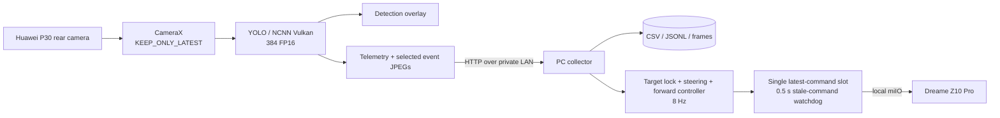

# Cat Stalker

**Computer vision + edge AI + Android + robotics, built as a reproducible experiment rather than presented as a finished autonomous product.**

[Русский](README_RU.md) · [Safe quick start](#safe-observation-no-robot-connection) · [Measured results](docs/RESULTS.md)


> **Current status — October 2026:** the end-to-end prototype has been exercised with a Huawei P30, on-device YOLO/NCNN inference, LAN telemetry, an 8 Hz controller, and local miIO control of a Dreame Z10 Pro. It can find, center, and approach a **calm, sitting cat** under tested apartment conditions. A walking cat can outrun the robot's measured turn response, so continuous pursuit of a moving cat is **not demonstrated**. Human supervision and a stop control remain mandatory.

## At a glance

| Question | Answer |
|---|---|
| **Task** | Detect the real cat, keep it near the horizontal image center, and approach conservatively. |
| **Hardware** | Huawei P30 in landscape on a Dreame Z10 Pro; Windows PC on the same private LAN. |
| **Perception** | YOLO11-derived single-class cat detector, NCNN Vulkan FP16 at 384 px on the phone. |
| **Data path** | CameraX → NCNN → telemetry/event JPEGs → PC collector → controller → latest-command robot worker → local miIO. |
| **Already works** | On-device detection; telemetry collection; watchdogs; latest-command semantics; local robot control; centering/approach of a calm cat; explicit no-robot observation mode. |
| **Experimental** | Autonomous `follow` and `patrol`, target reacquisition, apparent-area distance control, custom detector generalization. |
| **Not implemented / planned** | Reliable pursuit of a walking cat, odometry-aware search, map/pose integration, calibrated metric distance, product-grade obstacle and pet safety. |

## System architecture



The phone performs inference locally; video is not sent to a cloud service. The PC receives structured telemetry and selected event images. The robot worker never queues old movement commands. Details: [Android runtime](android/README.md), [session orchestration](session/README.md), and the preserved engineering log in [AGENTS.md](AGENTS.md).

## Evidence and measured results

These are measurements from this prototype—not vendor benchmarks or general guarantees.

| Measurement | Observed result | Scope / caveat |
|---|---:|---|
| P30 NCNN 384 FP16, native YUV | ~100–120 ms inference, ~8–9 FPS sustained | Huawei P30; transient touch boost reached 12–15 FPS and is **not** used as the control baseline. |
| Legacy USB/PC YOLO loop | ~33 ms inference, ~12.4 FPS whole loop | Windows, 640×480 MJPEG, `imgsz=480`. |
| Dreame application RTT | ~18 ms | Observed after continuous `move` traffic woke the robot Wi-Fi. |
| Phone → controller loop | 8 Hz | Telemetry is uploaded in ~0.5 s batches; forward motion requires frame age ≤0.5 s. |
| Active v5 detector validation | P 0.937, R 0.939, mAP50 0.958, mAP50–95 0.773 | Local held-out split from Huawei P30 apartment recordings; see the training report. |

**Dataset warning:** detector precision/recall and mAP were measured on a small, local, video-disjoint dataset recorded in one apartment with one phone and one cat. They do **not** imply comparable accuracy for other cats, rooms, lighting, viewpoints, phones, or printed-cat distractors. Earlier models scored highly offline and still failed on real pillows/keyboards; on-device runtime tests remain the acceptance gate.

See [docs/RESULTS.md](docs/RESULTS.md) for provenance, rejected experiments, control parameters, and interpretation; see [data/p30_cat_training_results.md](data/p30_cat_training_results.md) for the full model lineage.

## What works, what is experimental

### Demonstrated

- Huawei P30 CameraX capture and local NCNN Vulkan inference.
- Cat box, confidence, normalized horizontal offset, apparent bbox area, inference time, FPS, battery, and disk telemetry.
- PC collection into per-session CSV/JSONL plus selected event JPEGs.
- Local Dreame action mapping, measured RTT, idle Wi-Fi keepalive, a single latest-command slot, and stale-command timeout.
- Target centering and forward approach to a calm sitting cat in supervised apartment tests.
- Stop/hold on stale telemetry, uncertain target state, link degradation, device faults, and session watchdogs.
- Legacy USB-camera + ByteTrack + Xbox manual-override prototype in [`cat_stalker.py`](cat_stalker.py).

### Experimental—not a safety claim

- `--mode follow`: persistence/EMA target lock (the phone does not yet provide ByteTrack IDs), steering, area-based approach, and timed search sweeps.
- `--mode patrol`: in-place data-collection rotation.
- Reacquisition after brief occlusion and custom v5 detector behavior outside the recorded apartment scenes.
- Apparent bbox area as distance proxy; it is not metric ranging and depends on pose and viewpoint.

### Known limitations

- **Moving-cat pursuit:** a walking cat was observed to move across the camera faster than the platform could rotate (roughly 28°/s apparent tangential motion versus about 9°/s measured at a representative rotation command). The robot may lag, lose the target, and stop/search. Do not claim continuous moving-target following.
- Printed cats, artwork, cushions, keyboards, backlight, lying posture, partial occlusion, and distances around 4 m+ remain difficult.
- The Z10 Pro starts its vacuum motor in manual-control mode; the code requests Quiet, but cannot fully disable the fan through the known interface.
- No metric depth, robot pose/odometry feedback, true wheel-stuck detection, or autonomous reverse.
- Landscape phone mounting is validated; portrait steering geometry is not.
- This is not safe around stairs, cables, children, other pets, fragile objects, or unattended animals.

## Safe observation: no robot connection

The safest reproducible path exercises phone inference, discovery, telemetry, dashboard, and persistence while **hard-disabling every Dreame connection and command**, even if credentials exist in your shell:

```powershell
git clone https://github.com/kwexz/cat-stalker.git
cd cat-stalker
python -m venv .venv
.\.venv\Scripts\Activate.ps1
python -m session.auto_session --mode observe --no-robot --duration-min 5
```

The collector/session path uses the Python standard library; no model, camera, Android device, token, or robot is needed to start it. Open `http://127.0.0.1:8765/` locally. If the P30 app is available on the same trusted LAN, set its PC host or use UDP discovery; detections then appear in the dashboard and `sessions/<stamp>/phone_telemetry.csv`.

`--mode observe` by itself never requests non-zero movement, but with valid robot credentials it intentionally connects and sends `move(0,0)` keepalives. Use **`--no-robot`** when “no physical command whatsoever” is required.

Hardware-free checks (Python 3.10+; CI currently uses 3.12):

```powershell
python -m unittest discover -s tests -v
```

These checks use only the standard library and must not contact a robot, phone, or model runtime.

## Full hardware run (deliberate opt-in)

Only proceed after the no-robot path works. Keep the robot on the floor, clear of stairs/cables/pets; mount the phone in **landscape** without loading the lidar turret; keep a human at the physical stop/manual control.

```powershell
python -m pip install -r requirements.txt
$env:DREAME_IP="192.0.2.10"       # replace locally; documentation-only address
$env:DREAME_TOKEN="..."           # never commit or paste into logs/issues

# Deliberate physical-motion mode—read session/README.md first:
python -m session.auto_session --mode follow --duration-min 5
```

The phone and PC must share a trusted LAN. The Android uploader uses plain HTTP on that LAN; do not expose collector ports to the Internet. Full setup, firewall, watchdog, mount, and speaker-signal instructions: [session/README.md](session/README.md).

## Reproducible experiment structure

| Path | Purpose |
|---|---|
| [`android/`](android/) | Kotlin/CameraX app, TFLite baseline, NCNN Vulkan/native-YUV runtime. |
| [`session/`](session/) | PC collector, discovery, watchdogs, controller, and robot-link worker. |
| [`data/`](data/) | Label manifests and experiment reports; private bulk images/videos are excluded. |
| [`tools/`](tools/) | Dataset preparation, review, evaluation, export, and hardware-free harnesses. |
| [`docs/RESULTS.md`](docs/RESULTS.md) | Consolidated measured results and controller configuration. |
| [`AGENTS.md`](AGENTS.md) | Preserved dated engineering findings and motion constraints. |
| [`PROJECT_CONTEXT.md`](PROJECT_CONTEXT.md) | Historical handoff notes, including the earlier USB-camera prototype. |

Raw videos, extracted photos, session frames/logs, generated runs, local environment files, and most model artifacts are ignored. The single published project photo above is intentionally included; it shows the author's real cat and home, so redistribution should be treated as personal media rather than dataset material.

Reproducibility boundary: the hardware-free PC checks run from a clean clone.
Exact detector retraining/evaluation still requires the private source media,
and the Android project currently relies on Android Studio or a locally
generated Gradle wrapper because wrapper files are not committed.

## Models, data, and licensing

- The repository's original source code is licensed under [MIT](LICENSE).
- **Ultralytics software and YOLO model artifacts are not relicensed by this MIT file.** Ultralytics currently offers AGPL-3.0 and Enterprise terms; evaluate the terms that apply to training, export, redistribution, embedding, network use, and commercial deployment: [Ultralytics licensing](https://www.ultralytics.com/license) and [upstream LICENSE](https://github.com/ultralytics/ultralytics/blob/main/LICENSE).
- Base `yolo11n` weights originate from Ultralytics and COCO training. COCO images/annotations and third-party source images retain their own terms; review the [COCO terms of use](https://cocodataset.org/#termsofuse). No COCO images are included here.
- The local P30 recordings, labels, and fine-tuned weights are separate artifacts. Raw/private media are not published; tracked text manifests are an audit trail, not a distributable image dataset.
- NCNN, Android/CameraX, `python-miio`, OpenCV, pygame, and their transitive dependencies retain their upstream licenses. Review notices before distributing an APK or binary bundle.

This is a practical separation of repository scope, not legal advice. See [THIRD_PARTY_NOTICES.md](THIRD_PARTY_NOTICES.md).

## Visual evidence

The real setup photo at the top shows the Huawei P30 mounted on the Dreame,
the actual cat, and the live `DETECTED` overlay. No simulated or generated
demonstration media are used. Runtime and closed-loop claims are supported by
the measured records summarized in [`docs/RESULTS.md`](docs/RESULTS.md), with
their limitations stated explicitly.
