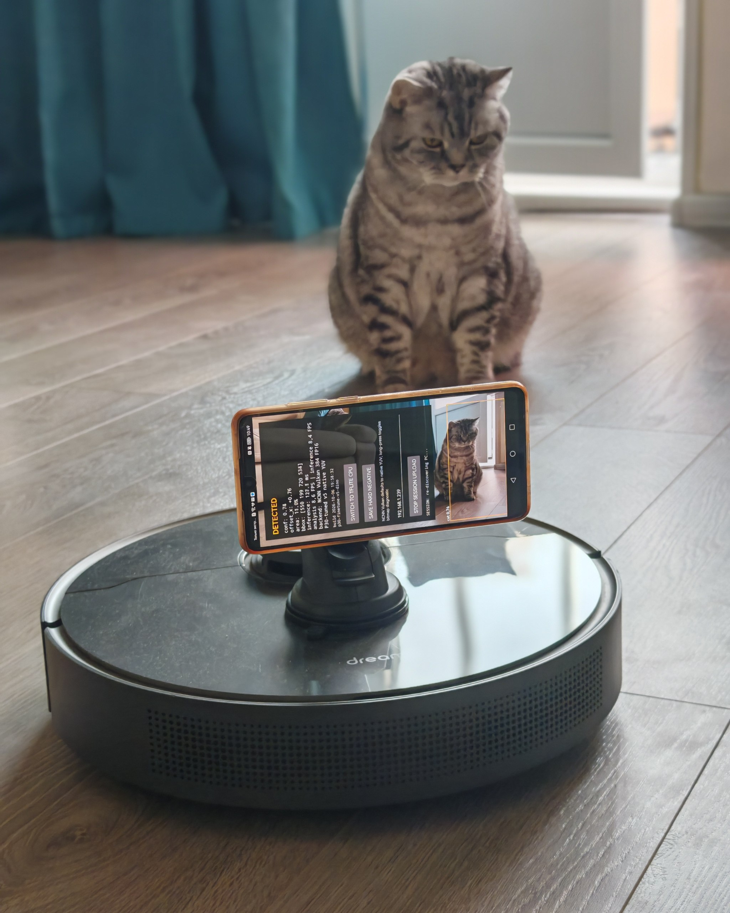
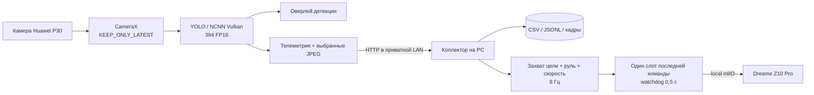

# Cat Stalker

**Воспроизводимый инженерный эксперимент на стыке Computer Vision, Edge AI, Android и робототехники — не готовый автономный продукт.**

[English](README.md) · [Безопасный запуск](#безопасное-наблюдение-без-подключения-к-роботу) · [Результаты](docs/RESULTS.md)



> **Состояние на октябрь 2026:** полный контур проверен с Huawei P30, YOLO/NCNN на телефоне, LAN-телеметрией, контроллером 8 Гц и локальным miIO-управлением Dreame Z10 Pro. В проверенных квартирных условиях робот находит, центрирует и приближается к **спокойному сидящему коту**. Идущий кот способен двигаться в кадре быстрее, чем поворачивается платформа, поэтому непрерывное преследование движущегося кота **не доказано**. Нужны человек рядом и доступный останов.

## Кратко

| Вопрос | Ответ |
|---|---|
| **Задача** | Найти настоящего кота, удерживать его около горизонтального центра кадра и осторожно приблизиться. |
| **Оборудование** | Huawei P30 горизонтально на Dreame Z10 Pro; Windows-PC в той же приватной LAN. |
| **Восприятие** | Одноклассовый детектор кота на базе YOLO11, NCNN Vulkan FP16, вход 384 px. |
| **Контур** | CameraX → NCNN → телеметрия/кадры событий → PC → контроллер → слот последней команды → local miIO. |
| **Уже работает** | Бортовой детект; сбор телеметрии; watchdog'и; локальное управление; центрирование/подход к спокойному коту; явный режим наблюдения без робота. |
| **Экспериментально** | `follow`/`patrol`, повторный поиск, управление дистанцией по площади bbox, обобщение своего детектора. |
| **Планируется** | Надёжное сопровождение идущего кота, поиск с одометрией, карта/поза, метрическая дистанция, продуктовый уровень безопасности. |

## Архитектура



Инференс выполняется на телефоне; видео не отправляется в облако. PC получает структурированную телеметрию и выбранные кадры событий. Старые команды движения не накапливаются. Детали: [Android](android/README.md), [сессии](session/README.md), сохранённый журнал исследований [AGENTS.md](AGENTS.md).

## Доказательства и измерения

Это измерения конкретного прототипа, а не общие гарантии.

| Измерение | Результат | Условия / оговорка |
|---|---:|---|
| P30, NCNN 384 FP16, native YUV | ~100–120 мс, ~8–9 FPS стабильно | Краткий boost после касания давал 12–15 FPS, но это не базовый режим управления. |
| Старый USB/PC-контур YOLO | ~33 мс инференс, ~12,4 FPS весь цикл | Windows, MJPEG 640×480, `imgsz=480`. |
| Прикладной RTT Dreame | ~18 мс | После пробуждения Wi-Fi непрерывными `move`-командами. |
| Контроллер | 8 Гц | Телеметрия отправляется батчами около 0,5 с; движение вперёд требует возраста кадра ≤0,5 с. |
| Валидация активного v5 | P 0,937; R 0,939; mAP50 0,958; mAP50–95 0,773 | Локальный отложенный split из квартирных записей Huawei P30; детали в training report. |

**Ограничение датасета:** precision/recall и mAP измерены на небольшом локальном video-disjoint наборе из одной квартиры, одного телефона и одного кота. Они **не гарантируют** такого же качества для других котов, помещений, света, ракурсов, телефонов и изображений котов на предметах. Ранние модели показывали высокие offline-метрики, но ошибались на подушках и клавиатуре; приёмочным тестом остаётся проверка на P30.

Происхождение результатов, отклонённые эксперименты и параметры управления: [docs/RESULTS.md](docs/RESULTS.md). Полная история моделей: [data/p30_cat_training_results.md](data/p30_cat_training_results.md).

## Статус возможностей

### Подтверждено

- CameraX на Huawei P30 и локальный NCNN Vulkan inference.
- Bbox кота, confidence, нормализованный горизонтальный offset, площадь bbox, latency/FPS, батарея и диск в телеметрии.
- Запись на PC в CSV/JSONL и выбранные JPEG событий.
- Local miIO, измерение RTT, Wi-Fi keepalive, единственный слот команды и timeout протухшей команды.
- Центрирование и приближение к спокойному сидящему коту под надзором.
- Останов/удержание при протухшей телеметрии, неопределённой цели, проблемах связи, fault устройства и watchdog'ах.
- Старый USB + ByteTrack + Xbox-прототип в [`cat_stalker.py`](cat_stalker.py).

### Экспериментально

- `--mode follow`: захват цели по устойчивости/EMA без ByteTrack ID, руление, подход по площади bbox и поисковые повороты.
- `--mode patrol`: вращение на месте для сбора данных.
- Повторный захват после перекрытия и работа v5 вне записанных сцен.
- Площадь bbox как приблизительная дистанция — это не метрический дальномер.

### Известные ограничения

- **Идущий кот:** наблюдалось угловое движение около 28°/с против примерно 9°/с поворота платформы на репрезентативной команде. Робот может отстать, потерять цель и остановиться/перейти к поиску. Нельзя заявлять надёжное непрерывное преследование.
- Печатные коты, картины, подушки, клавиатуры, контровой свет, лежащая поза, перекрытие и расстояния около 4 м+ остаются сложными.
- Ручной режим Z10 Pro включает мотор пылесоса; код запрашивает Quiet, но известный интерфейс не отключает его полностью.
- Нет метрической глубины, одометрии/позы, истинного определения заблокированных колёс и автономного заднего хода.
- Проверена только горизонтальная установка телефона.
- Небезопасно у лестниц, проводов, детей, других животных, хрупких предметов и без наблюдения человека.

## Безопасное наблюдение без подключения к роботу

Этот путь проверяет коллектор, dashboard и сохранение данных, при этом **жёстко запрещает любое подключение и команды Dreame**, даже если токен случайно остался в окружении:

```powershell
git clone https://github.com/kwexz/cat-stalker.git
cd cat-stalker
python -m venv .venv
.\.venv\Scripts\Activate.ps1
python -m session.auto_session --mode observe --no-robot --duration-min 5
```

Для запуска PC-части не нужны модель, камера, Android, токен или робот. Откройте локально `http://127.0.0.1:8765/`. Если приложение P30 доступно в той же доверенной LAN, укажите адрес PC или используйте UDP discovery — данные появятся в dashboard и `sessions/<stamp>/phone_telemetry.csv`.

Сам `--mode observe` не просит ненулевого движения, но при наличии credentials подключается к роботу и посылает `move(0,0)` keepalive. Если нельзя отправлять **вообще никаких** физических команд, обязателен **`--no-robot`**.

Проверки без оборудования (Python 3.10+; CI использует 3.12):

```powershell
python -m unittest discover -s tests -v
```

Они используют только стандартную библиотеку и не должны обращаться к роботу, телефону или модели.

## Полный аппаратный запуск — только осознанно

Сначала проверьте no-robot режим. Робот должен стоять на полу вдали от лестниц, проводов и животных; телефон — горизонтально и без нагрузки на лидар; человек — рядом с физическим остановом.

```powershell
python -m pip install -r requirements.txt
$env:DREAME_IP="192.0.2.10"       # заменить локально; это адрес-пример
$env:DREAME_TOKEN="..."           # не коммитить и не вставлять в issue/логи

# Режим физического движения — сначала прочитать session/README.md:
python -m session.auto_session --mode follow --duration-min 5
```

Телефон и PC должны быть в доверенной LAN. Android использует plain HTTP; не публикуйте порты коллектора в Internet. Полная инструкция и watchdog'и: [session/README.md](session/README.md).

## Структура эксперимента

| Путь | Назначение |
|---|---|
| [`android/`](android/) | Kotlin/CameraX, TFLite baseline, NCNN Vulkan/native YUV. |
| [`session/`](session/) | Коллектор, discovery, watchdog'и, контроллер и robot worker. |
| [`data/`](data/) | Текстовые manifests и отчёты; приватные фото/видео исключены. |
| [`tools/`](tools/) | Подготовка/ревью данных, оценка, экспорт и harness'ы. |
| [`docs/RESULTS.md`](docs/RESULTS.md) | Сводные измерения и параметры управления. |
| [`AGENTS.md`](AGENTS.md) | Сохранённые датированные находки и ограничения motion-кода. |
| [`PROJECT_CONTEXT.md`](PROJECT_CONTEXT.md) | История, включая ранний USB-прототип. |

Raw-видео, извлечённые фото, session frames/logs, training runs, локальные env-файлы и большинство моделей игнорируются git. Единственное публичное фото выше добавлено намеренно; на нём реальный кот и интерьер автора, поэтому это личный демонстрационный материал, а не часть датасета.

Граница воспроизводимости: PC-проверки без оборудования работают из чистого
clone. Точное повторение обучения/оценки требует приватных source media, а для
Android сейчас нужен Android Studio или локально созданный Gradle wrapper,
поскольку wrapper-файлы не закоммичены.

## Модели, данные и лицензии

- Собственный исходный код репозитория — [MIT](LICENSE).
- **Ultralytics и артефакты YOLO не становятся MIT-кодом этого проекта.** У Ultralytics действуют AGPL-3.0 и Enterprise-варианты; перед обучением, экспортом, встраиванием, распространением или коммерческим использованием проверьте [условия Ultralytics](https://www.ultralytics.com/license) и [upstream LICENSE](https://github.com/ultralytics/ultralytics/blob/main/LICENSE).
- Базовые веса `yolo11n` происходят от Ultralytics и обучения на COCO. Изображения/аннотации COCO и сторонние материалы сохраняют собственные условия: [COCO terms](https://cocodataset.org/#termsofuse). Изображения COCO здесь не публикуются.
- Локальные записи P30, labels и fine-tuned weights — отдельные артефакты. Приватные media не опубликованы; текстовые manifests нужны для аудита, а не заменяют распространяемый датасет.
- NCNN, Android/CameraX, `python-miio`, OpenCV, pygame и зависимости сохраняют upstream-лицензии. Перед распространением APK/бинарников нужен аудит notices.

Это разделение области лицензий, а не юридическая консультация. Подробнее: [THIRD_PARTY_NOTICES.md](THIRD_PARTY_NOTICES.md).

## Визуальное подтверждение

Реальное фото в начале README показывает Huawei P30 на Dreame, настоящего
кота и живой оверлей `DETECTED`. Сгенерированные или имитирующие работу
материалы не используются. Измерения полного контура собраны в
[`docs/RESULTS.md`](docs/RESULTS.md) вместе с явными ограничениями.
